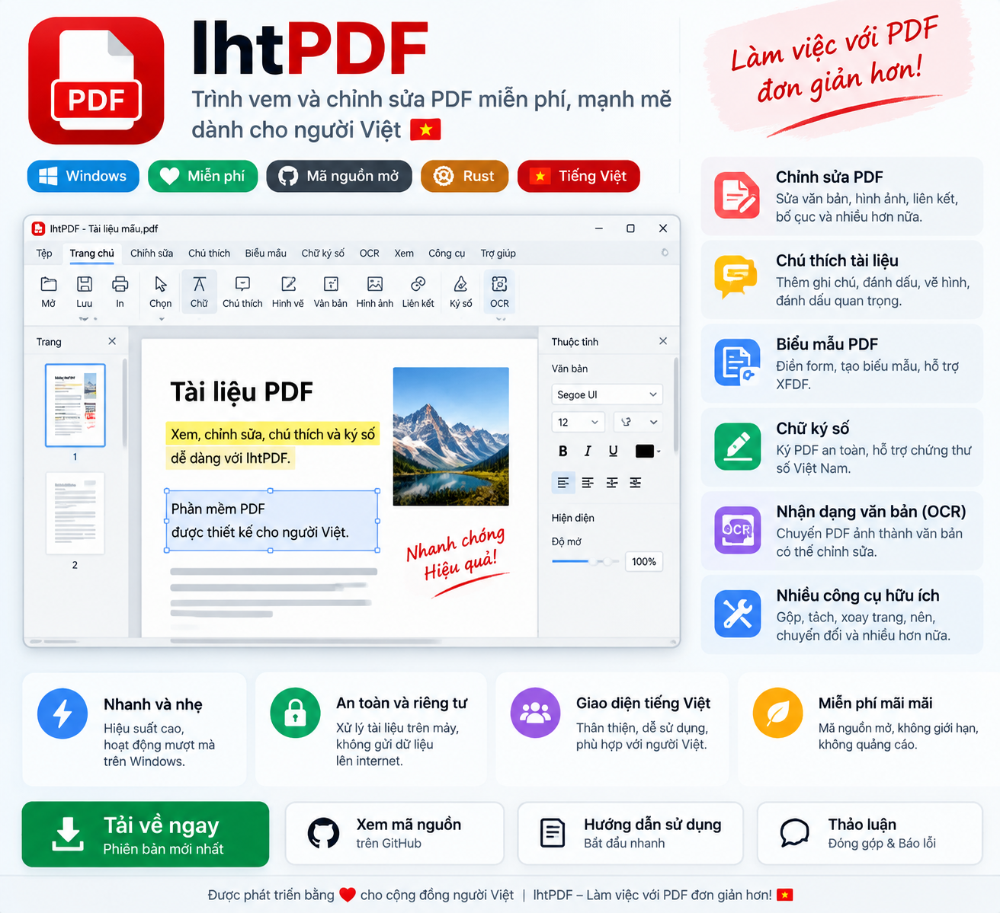
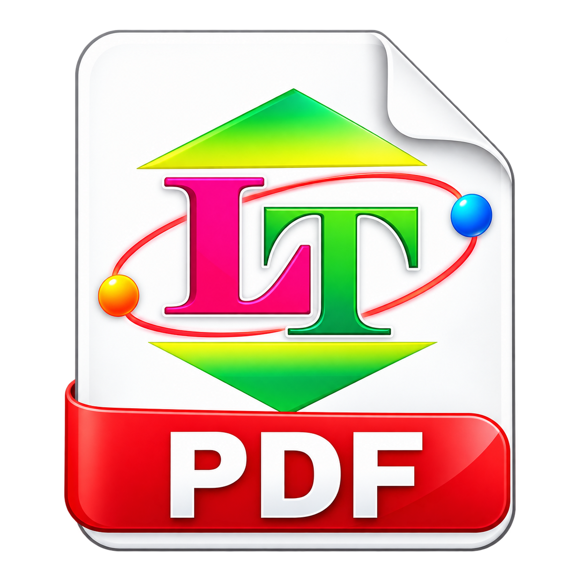

# lhtPDF

### Làm việc với PDF đơn giản hơn

**Ứng dụng đọc, chỉnh sửa và xử lý tài liệu PDF dành cho Windows, hỗ trợ tiếng Việt.**

**[TẢI LHTPDF](https://github.com/lht99/lhtPDF/releases/latest)** |
**[TRANG CHỦ](https://letuan.io.vn)** |
**[GÓP Ý / BÁO LỖI](https://github.com/lht99/lhtPDF/issues)**

---

## Giới thiệu

**lhtPDF** là ứng dụng Windows giúp người dùng mở, xem, chỉnh sửa và xử lý tài liệu PDF.

Phần mềm được phát triển dựa trên dự án mã nguồn mở [PdfCraft](https://github.com/storytold/pdfcraft), với bộ nhận diện lhtPDF và giao diện hỗ trợ tiếng Việt.

Một số chức năng phụ thuộc vào phiên bản ứng dụng và các thành phần được đóng gói.

## Tính năng nổi bật

| Tính năng | Mô tả |
| --- | --- |
| 📖 Đọc PDF | Mở và xem tài liệu PDF |
| ✏️ Chỉnh sửa | Chỉnh sửa và chú thích tài liệu |
| 📑 Quản lý trang | Sắp xếp, ghép và tách PDF |
| 📝 Biểu mẫu | Làm việc với biểu mẫu PDF |
| 🔍 OCR | Nhận dạng văn bản trong tài liệu |
| 📤 Xuất PDF | Xử lý và xuất tài liệu PDF |
| 🌐 Tiếng Việt | Giao diện tiếng Việt và tiếng Anh |

## Biểu tượng tài liệu

## Tải về
<!-- LHTPDF_DOWNLOAD_START -->
| Tệp | Mô tả |
| --- | --- |
| [Tải MSI Installer](https://github.com/lht99/lhtPDF/releases/download/26.10.22/lhtPDF-26.10.22-windows-x64.msi) | Cài đặt lhtPDF trên Windows |
| [Tải Portable ZIP](https://github.com/lht99/lhtPDF/releases/download/26.10.22/lhtPDF-26.10.22-windows-x64-portable.zip) | Giải nén và chạy ứng dụng |
<!-- LHTPDF_DOWNLOAD_END -->

### Lưu ý Windows SmartScreen

Ứng dụng có thể chưa được ký số bằng chứng thư được Windows tin cậy, vì vậy Windows SmartScreen có thể hiển thị cảnh báo.

Chỉ tải phần mềm từ kho GitHub chính thức hoặc website dự án. Nên kiểm tra mã SHA-256 trước khi sử dụng.

## Lịch sử phát hành

<!-- LHTPDF_RELEASE_HISTORY_START -->
### [26.10.22](https://github.com/lht99/lhtPDF/releases/tag/26.10.22) — 2026-10-22 (Stable)

- Phiên bản lhtPDF 26.10.22 tập trung cập nhật nhận diện thương hiệu, cải thiện khả năng chỉnh sửa văn bản tiếng Việt trong tài liệu PDF và khắc phục một số lỗ...
- 1. Cập nhật nhận diện lhtPDF
- Đồng bộ tên ứng dụng, biểu tượng và thông tin sản phẩm theo thương hiệu lhtPDF.
- [Tải MSI](https://github.com/lht99/lhtPDF/releases/download/26.10.22/lhtPDF-26.10.22-windows-x64.msi)
- [Tải Portable ZIP](https://github.com/lht99/lhtPDF/releases/download/26.10.22/lhtPDF-26.10.22-windows-x64-portable.zip)

### [26.10.21](https://github.com/lht99/lhtPDF/releases/tag/26.10.21) — 2026-10-20 (Stable)

- Phiên bản lhtPDF 26.10.21 tập trung cải thiện khả năng nhập liệu, hiển thị và chỉnh sửa văn bản tiếng Việt trong tài liệu PDF.
- Add Text: Cải thiện khả năng nhập trực tiếp tiếng Việt có dấu bằng UniKey và các bộ gõ tương thích.
- Edit Text: Cải thiện xử lý văn bản Unicode tiếng Việt và khả năng hiển thị dấu.
- [Tải MSI](https://github.com/lht99/lhtPDF/releases/download/26.10.21/lhtPDF-26.10.21-windows-x64.msi)
- [Tải Portable ZIP](https://github.com/lht99/lhtPDF/releases/download/26.10.21/lhtPDF-26.10.21-windows-x64-portable.zip)

### [26.10.20](https://github.com/lht99/lhtPDF/releases/tag/26.10.20) — 2026-10-19 (Stable)

- Phiên bản này tiếp tục tích hợp các cải tiến từ PdfCraft, tập trung vào chỉnh sửa văn bản, xử lý font chữ và độ ổn định của tài liệu PDF.
- Cải thiện thao tác chỉnh sửa và thay thế văn bản có sẵn trong PDF.
- Hỗ trợ đọc, hiển thị, sao chép, dán và chỉnh sửa văn bản Unicode, bao gồm tiếng Việt.
- [Tải MSI](https://github.com/lht99/lhtPDF/releases/download/26.10.20/lhtPDF-26.10.20-windows-x64.msi)
- [Tải Portable ZIP](https://github.com/lht99/lhtPDF/releases/download/26.10.20/lhtPDF-26.10.20-windows-x64-portable.zip)
<!-- LHTPDF_RELEASE_HISTORY_END -->

## Hướng dẫn sử dụng

**Bản cài đặt MSI:** Tải tệp MSI, mở tệp và làm theo hướng dẫn cài đặt.

**Bản Portable:** Tải ZIP, giải nén và chạy ứng dụng trong thư mục đã giải nén.

## Biên dịch từ mã nguồn

### Yêu cầu

- Rust stable với Windows MSVC target.
- Visual Studio C++ Build Tools.
- Windows SDK.
- WiX Toolset 5.0.2 để đóng gói MSI.
- Kết nối Internet khi cần tải tài nguyên mô hình OCR.

### Build ứng dụng

    cargo build --locked --release --target x86_64-pc-windows-msvc -p pdfcraft -p pdfcraft-cli

### Đóng gói Windows MSI và Portable

    powershell.exe -NoProfile -ExecutionPolicy Bypass -File packaging/windows/package.ps1 -Arch x64

Tên crate Rust nội bộ vẫn được giữ là `pdfcraft` để tương thích với mã nguồn gốc.

## Ghi công dự án gốc

lhtPDF là dự án phát triển độc lập dựa trên mã nguồn mở **PdfCraft**.

**Dự án gốc:** https://github.com/storytold/pdfcraft

Xin chân thành cảm ơn các tác giả, nhà phát triển và cộng đồng đóng góp cho PdfCraft đã xây dựng và chia sẻ nền tảng mã nguồn mở.

Các thông báo bản quyền, ghi công tác giả và giấy phép liên quan được giữ nguyên.

Tài liệu tham khảo:

- [README dự án gốc](README-UPSTREAM.md)
- [Thông tin ghi công](ATTRIBUTION.md)
- [Thông báo bản quyền](NOTICE)

lhtPDF không phải bản phát hành chính thức của ArtCraft. Tên thương mại, nhãn hiệu và logo ArtCraft không thuộc phạm vi giấy phép mã nguồn.

## Giấy phép

Mã nguồn nền tảng PdfCraft được cấp phép kép:

- [MIT License](LICENSE-MIT)
- [Apache License 2.0](LICENSE-APACHE)

Các thành phần bên thứ ba tuân theo giấy phép tương ứng.

## Liên hệ và hỗ trợ

**Website:** https://letuan.io.vn

**GitHub:** https://github.com/lht99/lhtPDF

**Góp ý và báo lỗi:** https://github.com/lht99/lhtPDF/issues

---

**lhtPDF — Làm việc với PDF đơn giản hơn**

